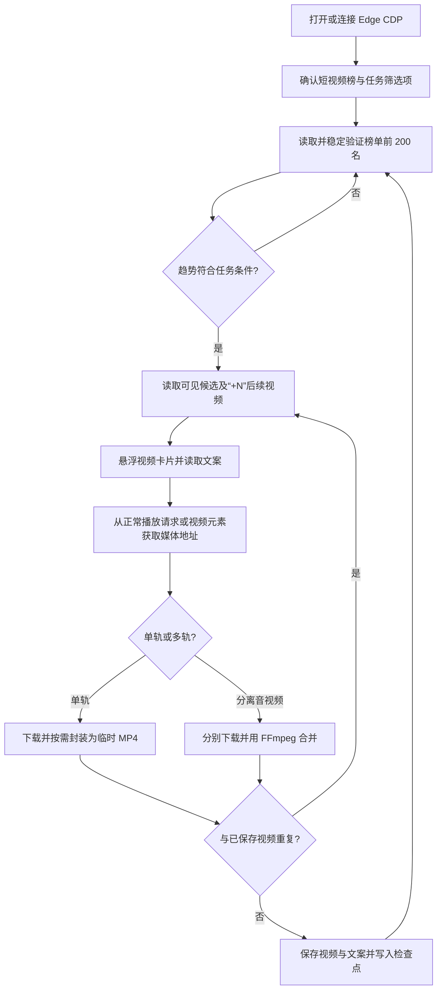

# 短视频榜采集工具：需求与技术方案

> 文档状态：已实现现状说明（截至 2026-09-27）；实现细节以当前代码为准。
> 项目：Tiktok video  
> 用途：说明当前功能、运行方式、数据位置和已知限制

## 1. 目标与范围

本工具在本机提供网页操作界面，打开或连接抖音电商罗盘 Edge 调试会话；登录和平台验证由用户手动完成。用户选择行业类目、品牌类型、榜单周期和趋势条件后，工具扫描短视频榜原始排名前 200 名，为符合条件的商品收集最多 4 条去重后的视频和对应文案，并保存到项目的视频目录。

本期包括：

- 单选行业类目、品牌类型和榜单周期。
- 选择“仅首次上榜”或“排名上升及首次上榜”。
- 扫描平台榜单原始排名 1 至 200，只处理符合所选条件的商品。
- 对每个符合条件的商品，按页面顺序检查可见视频卡片和“+N”后续候选；遇到重复项继续检查后续候选，最多保存 4 条不同视频，候选耗尽时尽量保证至少 2 条，但不保证一定能找到两条。
- 悬浮视频卡片读取对应文案；文案不同时为视频保存同名 `.txt`，文案完全一致时只保留第一份。
- 所有商品之间按 MP4 文件 SHA-256 和画面指纹去重视频。文案相同不作为视频重复的依据；不同视频全部保留，空白归一并忽略大小写后完全一致的文案只保留一份。画面指纹以抽样帧相似度近似判断，不做人脸或商品语义识别。
- 展示任务进度和日志，支持暂停、停止及从检查点续跑。

本期不包括：登录凭据管理、Cookie 导入或复制、验证码处理、访问限制绕过、去水印、超出前 200 名继续搜索、下载其他站点视频、榜单价格带筛选、批量多类目/多品牌组合。

## 2. 页面依据与筛选规则

### 2.1 当前页面观察

已通过 TOP200 使用的 Edge CDP 地址 `http://127.0.0.1:9222` 检查罗盘页面。当前页面实际激活的是“短视频榜”，周期是“近7天”，表格报告共 200 条商品；浏览器标题仍显示“商品卡排行”，与激活的榜单标签不一致。因此，程序判断目标榜单时应以页面当前激活的榜单标签和表格内容为准，不以浏览器标题为准。

商品的带货短视频区域会显示若干卡片，可能以“+N”表示还有候选。实现会先处理可见卡片，重复后再从“+N”弹层检查后续候选；弹层候选耗尽或收满 4 条不同视频后停止。

### 2.2 用户选项

| 选项 | 行为 |
|---|---|
| 行业类目 | 单选；选项从罗盘页面读取 |
| 品牌类型 | 单选：不限、知名品牌、非知名品牌 |
| 榜单周期 | 从页面当前提供的预设周期中单选；动态读取实时、近1天、近7天、近30天等可用项，不提供自定义日期范围 |
| 采集条件 | 单选：仅首次上榜；排名上升及首次上榜 |

页面未提供某个预设周期时，不显示该周期选项。新建任务时保存实际所选周期，避免续跑时页面默认周期变化而改变采集口径。

### 2.3 趋势与排名处理

按平台原始排名处理前 200 条记录，先识别趋势，再根据任务条件筛选：

| 页面趋势 | 识别值 | “仅首次上榜” | “排名上升及首次上榜” |
|---|---|---:|---:|
| 首次上榜 | `first` | 收集 | 收集 |
| 明确上升 | `up` | 跳过 | 收集 |
| 下降、持平、横线或空趋势 | `other` | 跳过 | 跳过 |
| 无法识别 | `unparseable` | 跳过并记错误 | 跳过并记错误 |

排名保留平台原始值，不按筛选后的商品重新编号。不得为了凑满 200 条符合条件结果而扫描第 200 名之后的商品。

## 3. 用户流程

1. 用户启动本机工具，程序打开或复用 Microsoft Edge 调试会话，先进入商机中心；登录可用后再进入罗盘短视频榜。
2. 如果登录过期，用户在商机中心手动完成登录和验证，再点击“打开短视频榜”。
3. 工具读取当前页面可用的行业类目、品牌类型和周期选项。
4. 用户单选类目、品牌类型、周期和趋势条件，创建采集任务。
5. 工具逐页稳定读取前 200 名，识别符合条件的商品。
6. 对每个符合条件的商品，按卡片从左到右的页面顺序处理视频候选，最多保存四条不同视频，并尽量达到两条：悬浮读取普通卡片文案；“+N”弹层里的候选直接点击；按画面去重后跳过重复项并继续检查后续候选。媒体通过已连接的浏览器会话流式写入临时文件。若卡片没有打开罗盘播放器而新开抖音网页，则关闭新标签页、记录该条失败，继续其他视频。
7. 工具在商品/视频边界写入检查点，更新界面进度和日志。
8. 任务结束后展示成功、失败、未读取到文案和未能下载的视频数量，以及结果目录。

任务按序执行，不并发打开多个视频播放器；一个视频失败不阻断同商品其他视频或后续商品。

## 4. 输出目录与文件命名

输出根目录固定为项目根目录下的 `视频` 文件夹，每个商品建立独立子目录：

```text
Tiktok video/
└─ 视频/
   └─ 鲜炖燕窝/
      ├─ 鲜炖燕窝1.mp4
      ├─ 鲜炖燕窝1.txt
      ├─ 鲜炖燕窝2.mp4
      └─ 鲜炖燕窝2.txt
```

- 商品开始下载前先读取前 4 个视频卡片的文案。商品文件夹名优先使用商品标题与这些文案全部共同包含的商品词，最多 24 个字符；“早餐”“营养”“食材”等泛场景词不作为商品主体。没有合适共同商品词时，退回清理后的商品标题，优先保证名称中包含商品主体。相同商品的文件夹名通过商品名和店铺名生成的标识索引保持稳定；目录冲突时追加该标识的短哈希。
- 视频与文案使用相同文件名主干：短商品名加已保存视频序号；`.txt` 使用 UTF-8，保存对应完整文案。同名输出会追加 `_2`、`_3` 等编号，不覆盖已有文件。
- 商品名和文案中的 Windows 非法字符、控制字符替换为下划线，首尾空格和句点去除。短商品名最长 24 个字符；文案全文不会用于视频文件名。
- 文案为空或读取失败时仍保留成功下载的视频，不生成空 `.txt`，并在任务日志中说明。
- 全局视频去重包含：MP4 SHA-256 相同；抽样画面指纹相似。开头 5 个抽样帧（约 0.5 至 4.5 秒）中至少 80% 可对齐，或完整指纹中较短视频至少 80% 的帧能与另一条按顺序匹配，即视为重复。完整指纹每秒取一帧，以 64 位差异哈希比较；较长指纹不足 12 帧时不做完整片段比对。文案单独去重：视频不同但文案完全一致时，保留所有视频，仅保留第一份 `.txt`。视觉分析不可用时，视频只按文件哈希去重。
- 每次任务开始会按路径顺序扫描已有 MP4 建立去重索引；发现重复项时删除重复视频及同名文案，保留先扫描到的一份。
- 下载先写入临时 `.part` 文件，完成并校验非空后再改为正式文件；失败时清理未完成临时文件。

## 5. 技术方案

### 5.1 运行方式

- 使用 Node.js 20+ 本机 HTTP 服务和静态网页界面；依赖版本由 `package-lock.json` 固定，并通过 `npm ci` 安装。
- 服务只监听 `127.0.0.1`，默认端口 `8080`；端口通过 `PORT` 环境变量覆盖。
- 使用 `playwright-core` 连接 Edge CDP，默认地址 `http://127.0.0.1:9222`，通过 `CDP_URL` 环境变量覆盖。已有调试会话时复用；否则按 TOP200 的方式启动独立调试版 Edge，不复制、导入或读取 Cookie 文件。
- 如需打开浏览器，由用户手动完成登录。工具不得读取密码、自动处理验证码或尝试绕过平台访问限制。

### 5.2 模块职责

| 模块 | 职责 |
|---|---|
| `server.js` | 本机 HTTP 服务、静态文件、API 会话令牌、任务控制和进度事件 |
| `edge.js` | Edge 自动发现/启动、CDP 连接和短视频榜页面校验 |
| `collector.js` | 选项读取、榜单筛选、视频候选遍历、下载、命名和去重流程 |
| `video-fingerprint.js` | 在本机 Edge 中解码 MP4，按抽样帧生成差异哈希和相似度 |
| `task-store.js` | 创建/读取任务、原子保存任务检查点和日志 |
| `public/` | 页面 HTML、CSS、交互和任务展示 |

页面识别以短视频榜 URL 路径、`role=tab` 的激活标签和表格中的“带货短视频”表头共同校验，不依赖浏览器标题。类目、品牌和周期用可见标签读取并在切换后校验；若目标榜单、表格结构或筛选项无法确认，任务停止并记录错误。页面 DOM 类名仍可能随平台更新变化。

### 5.3 采集和媒体流程



每个视频的媒体地址必须来自已连接页面能够正常访问的播放资源，例如 Playwright 监听到的媒体响应或播放器的 `currentSrc`。由该页面的浏览器会话读取媒体响应体，并分块写入临时文件；不从 Node 进程直接请求 CDN。过滤非媒体资源和不可访问地址。不得扩展为任意 URL 下载器、调用未授权下载服务或绕过平台限制。若悬浮没有触发媒体请求，只能沿页面可见、正常播放的路径尝试获取；失败时记录该视频并继续。

FFmpeg 是独立可选运行依赖。MP4 单轨视频不需要 FFmpeg；分离音视频轨道或单轨媒体不是 MP4 封装时需要。项目不随附或重新分发 FFmpeg；可将可执行文件加入 `PATH`，或通过 `FFMPEG_PATH` 指定路径。

### 5.4 当前任务接口

接口由本机网页调用。`GET /api/session` 获取随机会话令牌，其余 API 请求通过 `x-video-token` 请求头或 `token` 查询参数校验。

| 方法与路径 | 行为 |
|---|---|
| `GET /api/session` | 返回本机页面会话令牌 |
| `POST /api/edge-open` | 打开或连接调试版 Edge，并进入短视频榜 |
| `GET /api/edge-status` | 检查 Edge CDP 是否可连接及当前页面是否为短视频榜 |
| `GET /api/options` | 从当前页面读取类目、品牌类型和预设周期选项 |
| `GET /api/tasks` | 列出本地任务摘要 |
| `POST /api/tasks` | 使用单类目、单品牌、单周期、单趋势条件创建任务 |
| `GET /api/tasks/:id` | 返回任务状态、进度统计和错误摘要 |
| `POST /api/tasks/:id/pause` | 暂停任务并持久化检查点 |
| `POST /api/tasks/:id/resume` | 从最近检查点恢复任务 |
| `POST /api/tasks/:id/stop` | 停止任务并保留已完成文件和检查点 |
| `GET /api/events` | 以服务端事件流推送进度和日志 |

任务参数至少包含 `category`、`brandType`、`period` 和 `trendMode`；`trendMode` 仅允许 `first` 或 `up_and_first`。任务状态至少区分排队、运行、暂停、停止、完成和失败。进度至少报告已扫描商品数、符合条件商品数、视频成功数、重复跳过数、视频失败数及当前处理商品/视频。

## 6. 检查点与失败处理

- 任务筛选条件保存在任务记录中；检查点记录页码、原始排名、商品标识、候选序号、成功/失败候选、目录名和指纹索引等数据。
- 每个候选视频处理结束后写入检查点。暂停和停止会等待当前候选处理完毕；未完成的临时 `.part` 文件在清理阶段删除。
- 续跑复用任务创建时保存的筛选条件并跳过仍存在的已完成输出。续跑前校验榜单总数、每页条数和已记录的商品标识；不一致时停止，要求新建任务。
- 检查点中的输出路径为本机绝对路径，跨电脑或改变项目目录后直接续跑不受支持；轻量迁移包不包含任务数据和采集结果。
- 表格不稳定、翻页未成功、趋势无法解析、媒体地址无效、下载超时、磁盘不可写或 FFmpeg 失败都要写入任务日志，并关联商品和视频序号。
- 如果 Edge 断开、登录状态失效或出现验证码/访问限制，停止当前采集组合，保留检查点并提示用户恢复浏览器状态后续跑；不无限重试。
- 采集模块对页面加载、悬浮和请求等待使用有限次数重试与等待；不高频点击或刷新页面。

## 7. 隐私与安全边界

- 仅连接本机回环 CDP 和本机 HTTP 服务；API 校验会话令牌，媒体文件限制在项目 `视频` 目录，任务和日志分别存于 `data/`、`logs/`。
- 登录由用户在真实 Edge 中手动完成。禁止复制、导出、解密或迁移 Cookie，禁止保存账号密码。
- 只处理用户有权保存的内容，并遵守抖音平台规则、版权和隐私要求；不上传视频、文案、日志或任务数据，不增加遥测。
- 校验类目、品牌、周期和趋势枚举；对用户可影响的路径名做清理并确保最终路径位于 `视频` 根目录之下。
- 本机 HTTP 请求拒绝非回环访问；文件下载只接受从罗盘正常播放流程取得并验证为视频/音频媒体的资源。

## 8. 当前功能核对清单

1. 工具打开或连接 `127.0.0.1:9222` 的调试版 Edge，进入并正确识别激活的短视频榜；浏览器标题不一致时仍以实际激活标签判断。
2. 类目、品牌、预设周期和趋势条件可选择并写入任务；页面没有提供的周期不会显示为可选项。
3. “仅首次上榜”只处理首次上榜商品；“排名上升及首次上榜”只处理上升和首次上榜商品。扫描上限严格为平台原始前 200 名。
4. 每个符合条件的商品检查页面可见卡片及“+N”后续候选，最多保存 4 条不同视频；重复项会跳过并继续检查，候选耗尽时尽量保留至少 2 条。
5. 每条成功下载的视频与其文案使用相同序号和文件名主干，保存在商品目录；文案全文保存为 UTF-8 `.txt` 文件。
6. 文案读取失败时不生成空文案文件，保留成功下载的视频并记录失败；一条视频的失败不阻断其他视频或商品。
7. 下载文件经非空校验后才正式命名；中断不会留下未完成的最终文件，同名文件不会被覆盖。
8. 暂停/停止后任务状态和检查点持久化；续跑跳过已完成视频并从检查点继续。
9. 浏览器断开、页面结构变化、登录失效、验证码、媒体地址不可用和 FFmpeg 失败均有可读日志，并且不会触发无限重试或限制绕过。
10. 应用只监听回环地址；任务 API 校验会话令牌；媒体输出限制在项目 `视频` 目录，任务数据和日志分别保存在 `data/`、`logs/`。
11. 重复判断跨同商品和不同商品生效：文件哈希或抽样画面匹配时跳过重复视频；仅文案完全一致时保留所有不同视频，仅保留一份 `.txt`。画面相似度按帧指纹估算，不代表语义/人脸识别。新任务开始时也会清理已有重复视频和重复文案。

## 9. 参考实现

- `D:\前端\ai\Script All\Tiktok TOP200`：仅参考本机网页、Node.js 模块分层、Edge CDP 连接、页面采集、任务状态/检查点和日志进度模式。
- `D:\前端\ai\抖音视频下载器（免 Python 版）`：仅参考媒体响应解析、流式下载、临时文件原子落盘、独立音视频轨道合并和逐条失败隔离思路。

两个目录是只读技术参考；新项目的实现和依赖应放在当前项目目录中。
