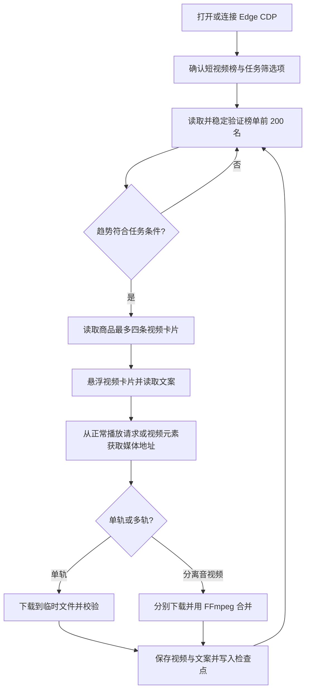

# 短视频榜采集工具：需求与技术方案

> 文档状态：需求规格与实现方案，尚未实现  
> 项目：Tiktok video  
> 用途：作为后续开发、验收和维护的依据

## 1. 目标与范围

本工具在本机提供一个类似 TOP200 的操作界面，打开或连接抖音电商罗盘 Edge 调试会话；登录和平台验证由用户手动完成。用户选择行业类目、品牌类型、榜单周期和趋势条件后，工具扫描短视频榜前 200 名，对符合条件的商品收集最多四条带货短视频、对应视频文案，并保存到项目的视频目录。

本期包括：

- 单选行业类目、品牌类型和榜单周期。
- 选择“仅首次上榜”或“排名上升及首次上榜”。
- 扫描平台榜单原始排名 1 至 200，只处理符合所选条件的商品。
- 每个符合条件的商品收集页面顺序最前的四条带货视频；不足四条时收集实际可见数量。
- 悬浮视频卡片读取对应文案，下载视频并为每条视频保存独立 `.txt` 文案。
- 所有商品之间按 MP4 文件 SHA-256、文案完全一致和画面指纹去重；开头 5 秒主体画面相似度达到 80%，或较短视频至少 80% 的主体内容能在另一视频中按顺序对齐时，不重复保存视频和对应文案。出现重复候选时继续检查“+N”里的后续视频，最多保存 4 条不同视频，并尽量保证至少 2 条。
- 展示任务进度和日志，支持暂停、停止及从检查点续跑。

本期不包括：登录凭据管理、Cookie 导入或复制、验证码处理、访问限制绕过、去水印、超出前 200 名继续搜索、下载其他站点视频、榜单价格带筛选、批量多类目/多品牌组合。

## 2. 页面依据与筛选规则

### 2.1 当前页面观察

已通过 TOP200 使用的 Edge CDP 地址 `http://127.0.0.1:9222` 检查罗盘页面。当前页面实际激活的是“短视频榜”，周期是“近7天”，表格报告共 200 条商品；浏览器标题仍显示“商品卡排行”，与激活的榜单标签不一致。因此，程序判断目标榜单时应以页面当前激活的榜单标签和表格内容为准，不以浏览器标题为准。

截图中每个商品的带货短视频区域显示四张视频卡片，后面以“+N”表示还有其他视频。工具只收集页面顺序最前的四条，不打开“+N”收集更多。鼠标悬浮视频卡片时可见对应文案。

### 2.2 用户选项

| 选项 | 行为 |
|---|---|
| 行业类目 | 单选；选项从罗盘页面读取 |
| 品牌类型 | 单选：不限、知名品牌、非知名品牌 |
| 榜单周期 | 从页面当前提供的预设周期中单选；动态读取实时、近1天、近7天、近30天等可用项，不提供自定义日期范围 |
| 采集条件 | 单选：仅首次上榜；排名上升及首次上榜 |

页面未提供某个预设周期时，不显示该周期选项。新建任务时保存实际所选周期，避免续跑时页面默认周期变化而改变采集口径。

### 2.3 趋势与排名处理

按平台原始排名处理前 200 条记录，先识别趋势，再根据任务条件筛选：

| 页面趋势 | 识别值 | “仅首次上榜” | “排名上升及首次上榜” |
|---|---|---:|---:|
| 首次上榜 | `first` | 收集 | 收集 |
| 明确上升 | `up` | 跳过 | 收集 |
| 下降、持平、横线或空趋势 | `other` | 跳过 | 跳过 |
| 无法识别 | `unparseable` | 跳过并记错误 | 跳过并记错误 |

排名保留平台原始值，不按筛选后的商品重新编号。不得为了凑满 200 条符合条件结果而扫描第 200 名之后的商品。

## 3. 用户流程

1. 用户启动本机工具，程序打开或复用 Microsoft Edge 调试会话，先进入商机中心；登录可用后再进入罗盘短视频榜。
2. 如果登录过期，用户在商机中心手动完成登录和验证，再点击“打开短视频榜”。
3. 工具读取当前页面可用的行业类目、品牌类型和周期选项。
4. 用户单选类目、品牌类型、周期和趋势条件，创建采集任务。
5. 工具逐页稳定读取前 200 名，识别符合条件的商品。
6. 对每个符合条件的商品，按卡片从左到右的页面顺序处理视频候选，最多保存四条不同视频，并尽量达到两条：悬浮读取普通卡片文案；“+N”弹层里的候选直接点击；按画面去重后跳过重复项并继续检查后续候选。媒体通过已连接的浏览器会话流式写入临时文件。若卡片没有打开罗盘播放器而新开抖音网页，则关闭新标签页、记录该条失败，继续其他视频。
7. 工具在商品/视频边界写入检查点，更新界面进度和日志。
8. 任务结束后展示成功、失败、未读取到文案和未能下载的视频数量，以及结果目录。

任务按序执行，不并发打开多个视频播放器；一个视频失败不阻断同商品其他视频或后续商品。

## 4. 输出目录与文件命名

输出根目录固定为项目根目录下的 `视频` 文件夹，每个商品建立独立子目录：

```text
Tiktok video/
└─ 视频/
   └─ 鲜炖燕窝/
      ├─ 鲜炖燕窝1.mp4
      ├─ 鲜炖燕窝1.txt
      ├─ 鲜炖燕窝2.mp4
      └─ 鲜炖燕窝2.txt
```

- 商品文件夹名优先取商品名与视频文案中的共有商品词；选择前先忽略产地、促销和规格词，避免只取“俄罗斯”等产地词。没有合适共有词时使用清理后的商品核心名。一个商品在任务中固定使用同一个短名；不同商品产生相同目录名时追加商品短编号，避免混放。
- 视频与文案使用相同文件名主干，视频名由固定短商品名加视频序号组成；`.txt` 使用 UTF-8，保存对应完整文案。
- 文案为空或读取失败时仍按短商品名和序号命名视频，并在任务日志中说明。
- 商品目录名和文案文件名中的 Windows 非法字符及控制字符替换为下划线；首尾空格和句点去除；文件名文案部分截短至最多 80 个字符。
- 商品名为空时使用稳定商品 ID。若不同商品清理后得到相同目录名，在目录名后追加商品 ID；没有可用 ID 时追加递增序号。
- 同一目录中出现同名输出时追加 `_2`、`_3` 等编号，不覆盖已有文件。
- 全项目按 MP4 SHA-256、完全一致的文案或抽样画面指纹识别重复视频，保留先保存的一份。开头 5 秒对齐帧相似度达到 80% 时按同一主体处理；完整内容按每秒一帧、64 位差异哈希和弹性顺序对齐，以较短视频为分母，覆盖 80% 时按重复片段处理。最多保存 4 条不同视频；有更多候选时继续寻找，尽量保证至少 2 条不同视频。
- 下载先写入临时 `.part` 文件，完成并校验非空后再改为正式文件；失败时清理未完成临时文件。
- 只有视频下载成功但文案读取失败时，保留视频、不生成空文案文件，并将对应商品、视频序号和错误原因记录到任务日志。

## 5. 技术方案

### 5.1 运行方式

- 使用 Node.js 本机 HTTP 服务和静态网页界面，技术结构遵循 `Tiktok TOP200` 的 `server.js`、`edge.js`、采集模块和任务存储分层。
- 服务只监听 `127.0.0.1`，默认端口 `8080`；端口通过 `PORT` 环境变量覆盖。
- 使用 `playwright-core` 连接 Edge CDP，默认地址 `http://127.0.0.1:9222`，通过 `CDP_URL` 环境变量覆盖。已有调试会话时复用；否则按 TOP200 的方式启动独立调试版 Edge，不复制、导入或读取 Cookie 文件。
- 如需打开浏览器，由用户手动完成登录。工具不得读取密码、自动处理验证码或尝试绕过平台访问限制。

### 5.2 模块职责

| 模块 | 职责 |
|---|---|
| 本机 HTTP 服务 | 提供静态界面、任务 API、会话校验和进度事件 |
| Edge/CDP 连接 | 检查调试端点、连接已有 Edge、定位罗盘短视频榜 |
| 页面采集 | 读取筛选选项、表格、趋势、商品信息和视频卡片；等待表格稳定并验证翻页 |
| 视频解析与下载 | 悬浮读取文案；从页面正常播放流程读取可访问媒体地址；通过已连接浏览器会话流式下载并维护临时文件 |
| 音视频合并 | 媒体为独立音视频轨道时，用 FFmpeg 合并为 MP4；不得重新编码，除非后续需求另行确认 |
| 任务存储 | 保存任务输入、进度、商品/视频检查点、错误信息；通过原子写入避免半写状态 |
| 界面 | 提供筛选表单、任务状态、进度、日志，以及暂停、续跑和停止操作 |

页面选择器应依据可见文本、激活状态和稳定的行/卡片结构识别目标。当前页面 DOM 使用 `.aurora-tabs-tab-active` 表示激活标签，但该类名属于易变页面实现细节；应把选择器集中管理，并在找不到目标或表格结构改变时停止该组合、记录可诊断错误，不能误把其他榜单当作短视频榜。

### 5.3 采集和媒体流程



每个视频的媒体地址必须来自已连接页面能够正常访问的播放资源，例如 Playwright 监听到的媒体响应或播放器的 `currentSrc`。由该页面的浏览器会话读取媒体响应体，并分块写入临时文件；不从 Node 进程直接请求 CDN。过滤非媒体资源和不可访问地址。不得扩展为任意 URL 下载器、调用未授权下载服务或绕过平台限制。若悬浮没有触发媒体请求，只能沿页面可见、正常播放的路径尝试获取；失败时记录该视频并继续。

FFmpeg 作为新项目的独立运行依赖管理，需在实现阶段确定其合法分发来源和打包方式，不依赖或修改参考下载器目录中的可执行文件。

### 5.4 任务接口草案

接口均由本机网页调用，并要求服务端校验随机会话令牌。实际 JSON 字段可在实现中按任务存储结构落定，但行为保持如下：

| 方法与路径 | 行为 |
|---|---|
| `GET /api/session` | 返回本机页面会话令牌 |
| `GET /api/edge-status` | 检查 Edge CDP 是否可连接及当前页面是否为短视频榜 |
| `GET /api/options` | 从当前页面读取类目、品牌类型和预设周期选项 |
| `GET /api/tasks` | 列出本地任务摘要 |
| `POST /api/tasks` | 使用单类目、单品牌、单周期、单趋势条件创建任务 |
| `GET /api/tasks/:id` | 返回任务状态、进度统计和错误摘要 |
| `POST /api/tasks/:id/pause` | 暂停任务并持久化检查点 |
| `POST /api/tasks/:id/resume` | 从最近检查点恢复任务 |
| `POST /api/tasks/:id/stop` | 停止任务并保留已完成文件和检查点 |
| `GET /api/events` | 以服务端事件流推送进度和日志 |

任务参数至少包含 `category`、`brandType`、`period` 和 `trendMode`；`trendMode` 仅允许 `first` 或 `up_and_first`。任务状态至少区分排队、运行、暂停、停止、完成和失败。进度至少报告已扫描商品数、符合条件商品数、视频成功数、重复跳过数、视频失败数及当前处理商品/视频。

## 6. 检查点与失败处理

- 检查点至少记录当前类别、品牌、周期、趋势条件、榜单页码/原始排名、商品标识、视频序号和已完成输出路径。
- 每个视频保存完成后更新检查点；暂停和停止操作应先等待当前下载安全落盘或清理 `.part` 文件，再确认暂停/停止。
- 续跑时复用任务创建时保存的筛选条件，跳过已完成视频；不覆盖已存在的文件。
- 表格不稳定、翻页未成功、趋势无法解析、媒体地址无效、下载超时、磁盘不可写或 FFmpeg 失败都要写入任务日志，并关联商品和视频序号。
- 如果 Edge 断开、登录状态失效或出现验证码/访问限制，停止当前采集组合，保留检查点并提示用户恢复浏览器状态后续跑；不无限重试。
- 采集模块对页面加载、悬浮和请求等待使用有限次数重试与等待；不高频点击或刷新页面。

## 7. 隐私与安全边界

- 仅连接本机回环 CDP 和本机 HTTP 服务；API 校验会话令牌，输出文件限制在项目 `视频` 目录。
- 登录由用户在真实 Edge 中手动完成。禁止复制、导出、解密或迁移 Cookie，禁止保存账号密码。
- 只处理用户有权保存的内容，并遵守抖音平台规则、版权和隐私要求；不上传视频、文案、日志或任务数据，不增加遥测。
- 校验类目、品牌、周期和趋势枚举；对用户可影响的路径名做清理并确保最终路径位于 `视频` 根目录之下。
- 本机 HTTP 请求拒绝非回环访问；文件下载只接受从罗盘正常播放流程取得并验证为视频/音频媒体的资源。

## 8. 验收标准

1. 工具打开或连接 `127.0.0.1:9222` 的调试版 Edge，进入并正确识别激活的短视频榜；浏览器标题不一致时仍以实际激活标签判断。
2. 类目、品牌、预设周期和趋势条件可选择并写入任务；页面没有提供的周期不会显示为可选项。
3. “仅首次上榜”只处理首次上榜商品；“排名上升及首次上榜”只处理上升和首次上榜商品。扫描上限严格为平台原始前 200 名。
4. 每个符合条件的商品最多处理前四条视频卡片；视频数量少于四条时按实际数量处理；不会点开“+N”扩展列表。
5. 每条成功下载的视频与其文案使用相同序号和文件名主干，保存在商品目录；文案完整保存为 `.txt`，文件名清理后仍保留全文。
6. 文案读取失败时不生成空文案文件，保留成功下载的视频并记录失败；一条视频的失败不阻断其他视频或商品。
7. 下载文件经非空校验后才正式命名；中断不会留下未完成的最终文件，同名文件不会被覆盖。
8. 暂停/停止后任务状态和检查点持久化；续跑跳过已完成视频并从检查点继续。
9. 浏览器断开、页面结构变化、登录失效、验证码、媒体地址不可用和 FFmpeg 失败均有可读日志，并且不会触发无限重试或限制绕过。
10. 应用只监听回环地址；任务 API 校验会话令牌；所有输出均限制在项目 `视频` 目录内。
11. 重复视频跨商品或同商品出现时，只保存第一份视频与文案；较长视频至少 80% 的抽样画面匹配时计入跳过数，并可随检查点续跑。

## 9. 参考实现

- `D:\前端\ai\Script All\Tiktok TOP200`：仅参考本机网页、Node.js 模块分层、Edge CDP 连接、页面采集、任务状态/检查点和日志进度模式。
- `D:\前端\ai\抖音视频下载器（免 Python 版）`：仅参考媒体响应解析、流式下载、临时文件原子落盘、独立音视频轨道合并和逐条失败隔离思路。

两个目录是只读技术参考；新项目的实现和依赖应放在当前项目目录中。
