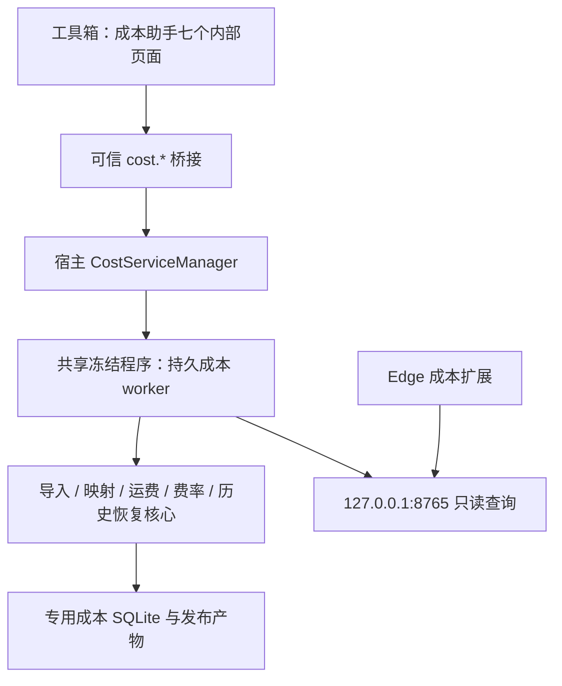

# 成本助手整改与工具箱接入方案

日期：2026-10-15

状态（2026-10-19）：**独立成本助手源码整改已完成，并生成独立安装包 0.2.0，位于成本助手目录的 `dist`；本轮仍未接入工具箱。** 安装包、本机同步和临时自检结果见[项目状态](<../Cost Accounting(成本价）/docs/项目状态与待办.md>)，此前源码证据见[整改实施记录](COST_ASSISTANT_RECTIFICATION_EXECUTION.md)。归档至 `local-archive/legacy-tools`、接入、开发目录删除和真实平台验收待后续步骤；本文接入内容仍为方案。

基线：工具箱 0.1.7；源码基线 `06f3156c07ac0302dce244b3f5358f27e31d6ff5`。

## 1. 结论与用户已确认的目标

可以接入工具箱，但应复用成本业务核心，补齐导入、服务恢复和写入保护后，再迁移界面与数据。不能只给现有独立程序加一个启动按钮就认为完成了接入。

用户已确认：

1. 当前主要故障表现是扩展提示“成本服务不可用”；有时平台页面仍开着，重启成本助手控制台后出现此问题。尚无本轮故障日志，不能断定后台崩溃。
2. 成本来源不限于聚水潭；不同平台、供应商的表格内容可能相同，但工作表、表头行、列位置和布局会变化。
3. **先维护一个生效成本目录，支持各种来源表格导入。** 首版不做多个成本源同时生效及自动择价。
4. 面向普通电商用户，文件选择、字段对应、预览和确认应在界面完成，不要求配置文件路径或 API 密钥。
5. 本轮交付分析和方案，不修代码、不接入工具箱。

建议的首版边界：通用 `.xlsx`、`.csv`、`.tsv` 单表导入，保留聚水潭普通表＋组合表预设；`.xls` 读取方案经隔离验证后开放。通用输入首先接收“一行一个 SKU、已有该 SKU 基础商品成本”的表格。

**多平台成本文件兼容，不等于自动支持各平台网页。** 成本目录和计算核心可与平台解耦；现有网页扩展仍先支持已实现的抖店页面，其他平台需要独立页面适配和验收。

## 2. 调查范围与证据边界

本轮由三个智能体分别只读分析导入与恢复、运行与扩展、运费与服务费，再汇总为本文。没有启动成本服务、执行测试、读取真实数据库或业务 Excel，也没有修改成本代码及安装程序。

| 分类 | 本文含义 |
| --- | --- |
| 源码确认 | 当前实现直接存在的行为或缺口，未必已经在用户实际版本复现 |
| 待复现 | 有实现依据的故障路径，需要版本、日志和隔离环境验证 |
| 建议设计 | 后续实现方向，不能当成现有功能 |
| 待确认口径 | 实施相关功能前需要明确的业务规则，不阻塞本轮方案交付 |

先前的[稳定性评估](TOOLBOX_COST_INTEGRATION_ASSESSMENT.md)保留为第一轮记录；涉及通用成本来源、首版导入范围和实施顺序，以本文为准。不以历史测试数量作为本轮通过证据。

## 3. 功能盘点与接入方式

工具箱增加一个一级入口“成本助手”，内部保留现有七个正式页面。无需把七页全部塞进左侧工具列表。

2026-10-19 用户确认的入口优先级：日常成本更新、商品对应关系、基础服务费及运费模板优先于更新历史和运行日志。独立版现已将基础服务费/运费模板前移至 04/05，历史/日志后移至 06/07。后续接入工具箱时保留日志能力，优先考虑放入详情或诊断入口，无需继续占用成本助手主侧栏；本轮先保留独立版日志入口并后置。

| 模块 | 可复用能力 | 接入前调整 |
| --- | --- | --- |
| 运行概览 | 成本目录、映射、服务信息 | 分开服务连接、数据完整性和配置缺项；统计异步加载 |
| 今日成本更新 | 配对预览、输入哈希、备份与发布 | 界面改为“成本导入与更新”；增加通用单表与布局映射 |
| 抖店商品对应关系 | 精确商家 SKU 匹配、店铺隔离、全量预览 | 同店全量替换需醒目标注；表格读取兼容，保留四级类目及重量上下文 |
| 基础服务费 | 类目规则、日期版本、启停、历史 | 区分当前/历史/未来版本；覆盖统计语义准确 |
| 运费模板 | Decimal 计费、地区价格、商品绑定 | 重整模板与绑定流程，共用正式试算，补齐状态和保存结果 |
| 更新历史 | 全局系统更新、备份、最近一次回滚 | 发布恢复记录统一；展示缺失备份原因 |
| 运行日志 | 现有运行记录 | 增加连接、超时、请求代次、启动身份等脱敏诊断 |
| Edge 只读扩展 | 报名页/编辑页读取及成本组件展示 | 同源身份校验、重启恢复、请求合并、错误分类 |
| 人工核验开发页 | 开发代码与数据 | 保留，正式版不自动开放、不因接入而删除 |

正式页面及开发边界依据：`Cost Accounting(成本价）/docs/AI执行限制与版本边界.md`；页面入口见 `cost_sync/webview_static/index.html:21`。

## 4. 表格兼容：读取向导与一个生效目录

### 4.1 当前限制与真正需要解决的问题

当前解析按表头名称定位列，**已经支持列顺序变化**；限制是只接受一个工作表、首行表头、指定必填字段。仅增加几个列名别名无法解决标题说明行、多工作表、价格口径和来源覆盖的问题。

还有两处必须对齐的契约：

- 普通表/组合表文档写 4/7 个必填字段，代码实际要求 6/9 个，额外要求创建和修改时间。
- 配对文件只比较工作簿创建日期，日期缺失会跳过；同一天并不能证明同一批次。没有可核实标记时显示“无法核实同批次”，不伪造证明。

依据：`cost_sync/catalog_import.py:31`、`:106`、`:335`、`:409`；项目技术设计文档第 79、81 行。

### 4.2 普通用户操作流程

```text
选择文件
  → 通用成本表 / 聚水潭普通＋组合表预设
  → 选择工作表和表头行（先显示原表预览）
  → 对应 SKU、成本、名称、状态等字段
  → 核对成本口径、来源范围、更新方式
  → 查看新增、修改、缺失、冲突及移除影响
  → 确认写入
  → 显示结果、备份与可恢复记录
```

唯一、精确的表头候选可以预选并展示；多个候选、重复列名、多个价格列或合并表头必须让用户选择。用户看到的是“第 3 行是表头”“商品编码对应这一列”，无需填写代码键名。

向导可保存“此类表格的格式模板”。模板保存结构和字段角色，下一次按新文件重新定位，不能盲用上次 B 列；结构变化时显示差异，重新确认。模板不自动授权全量替换，也不隐藏币种、成本口径和来源范围。

### 4.3 标准成本数据约定

| 字段/上下文 | 首版约定 |
| --- | --- |
| SKU | 精确文本身份，保留前导零、大小写和内部空格；沿用已有明确的规范化契约，不增加模糊匹配 |
| 商品名称 | 展示用，可为空；不能按名称自动合并两个编码 |
| 基础成本 | Decimal 或缺失；缺失不等于 0，合法明确的零成本与空值分开 |
| 启停状态 | 明确对应源值；没有状态列时，向导显示并确认本次状态策略 |
| 币种 | 首版人民币；其他币种明确阻断，不自动汇率换算 |
| 成本口径 | 单个销售 SKU 的基础商品成本；含运费/平台费的总成本不能直接混入，否则现有公式可能重复计费 |
| 来源范围 | 本商家的哪套 SKU 目录和商品范围；“来自某平台”不足以证明编码属于同一目录 |
| 导入清单 | 原文件名、SHA、工作表及坐标、编码/分隔符、映射、更新模式、来源范围、确认时间和契约版本 |

已有完整组合成本的 SKU 可作为单行导入；只有子件明细、整箱金额或采购总额的文件，需要明确数量与单位换算规则。首版保留现有聚水潭组合预设，不自动猜测通用 BOM、包装单位或采购金额拆分。

单次导入清单先复用更新记录 `details_json`，当前目录信息放在 `sync_state`。首版不增加多来源报价、自动优先级和逐行版本系统。

### 4.4 更新方式与来源冲突

| 模式 | 建议行为 | 保护要求 |
| --- | --- | --- |
| 通用增量更新，建议默认 | 新增/更新文件中出现的 SKU；未出现的不删除 | 停用需明确指令；冲突预览，不能按最后一行自动取值 |
| 当前整个目录全量替换 | 文件明确代表整个生效成本目录；重建目录 | 列出移除 SKU、受影响映射和配置；二次确认范围 |
| 聚水潭普通＋组合预设 | 保留现有配对全量语义 | 不为兼容通用表而静默改为追加；显示完整快照要求 |

“增量默认”是本文建议，尚未实现。一个生效目录可以接受多种格式，但新来源必须声明与当前目录使用同一套 SKU 身份。不同商家恰好同码不能自动覆盖。真正切换整套目录时，先核对旧抖店映射是否仍有意义；仅文本相等不足以自动确认。

同文件或同批次存在重复编码，需列出成本、名称、状态及来源差异；不同来源成本不自动取最低、最新或最后一条。聚水潭预设中已明确允许的普通空成本与完整组合成本折叠规则继续保留，不扩大到未知来源。

### 4.5 文件格式与资源限制

| 格式 | 读取方案 | 关键约束 |
| --- | --- | --- |
| XLSX | 复用 openpyxl | 保留类型和公式标记；选择 sheet/表头；不执行公式，缓存缺失不能当 0 |
| CSV/TSV | Python 标准库 csv | 支持引号、内嵌换行；预览编码与分隔符；不自动把 SKU 转数字 |
| XLS | 优先评估已有 SheetJS 的受限读取进程 | 保留类型/公式；进程时间、内存、行列有界；分片传输不等于流式解析 |

CSV 优先 UTF-8/BOM；GB18030 等由候选预览确认，不用任意编码兜底掩盖错误。千位分隔符、小数符号及货币符号有歧义时让用户指定，混合格式列出问题行。

数字型 SKU、已丢失前导零或被源文件转成科学计数法的编码，不能猜原值。合并数据单元格不自动向下填充。损坏、加密及不支持文件给出明确结果。Excel 有缓存的公式是否接受须显示策略，不能把公式空缓存当原始空单元格。

沿用现有单文件 16 MiB、XLSX 展开 256 MiB、2048 个 ZIP 条目、25 万数据行保护，并为候选扫描增加工作表/行列范围上限。超限显示原因，不能静默截断后导入。CSV 和 XLS 同样必须限制读取资源。

已有商品标题读取器强制 `Sheet1`、A/B 两列，不可直接作为通用成本解析器；可复用的是 SheetJS 依赖。若 XLS 跨运行时复杂度更高，再评估小型专用读取库，不引入 pandas 等整套分析环境。

### 4.6 最小模块边界

- `tabular_source.py`：容器、安全限制、类型保真和 CSV 编码/分隔符。
- `table_layout.py`：工作表/表头候选、明确列映射、格式模板结构核对。
- `cost_import.py`：通用标准成本预览、来源及口径校验，调用共同发布流程。
- `catalog_import.py`：保留聚水潭适配与组合规则，抽出共同发布入口；不伪造空组合表调用旧接口。

建议桥接只增加检查来源、预览导入、确认导入三个职责。确认只提交后台预览凭证，不重新信任前端金额、任意路径或字段映射。

## 5. “成本服务不可用”的定位与恢复方案

### 5.1 目前能确定什么

1. 扩展部分页面解析、消息通信异常也会转成相同“不可用”状态，提示不能证明 Python 服务退出。见 `browser_extension/content.js:12`、`:45`。
2. 当前批次查询已有重试和降级，不能把历史“单批失败导致全局离线”当成仍未修复的当前问题。见 `background.js:130`。
3. 健康检查只随页面查询发生；内容脚本每秒检查路由变化，没有独立健康恢复循环。页面不变时，服务重启后未必重新查询。见 `background.js:104`、`content.js:101`。
4. 独立窗口关闭会停止自己拥有的服务；平台页面仍开着并不代表成本后台还在。见 `cost_sync/webview_app.py:604`。
5. 扩展固定连接 8765 端口，未核对数据源身份；独立版和工具箱并存时存在查错库风险。见 `background.js:5`、`:104`。
6. 当前健康接口还执行商品、映射和店铺统计；桌面探测 0.5 秒、扩展请求 4.5 秒。查询慢、锁等待、旧进程未退出等均需测量，不能先认定唯一根因。

### 5.2 服务与扩展状态

工具箱服务状态采用：未启用 → 启动中 → 就绪；失败时明确为端口占用、启动失败或恢复待处理。扩展采用：待核验 → 已连接 / 正在重连 / 查询失败 / 扩展通信异常 / 数据源不匹配。

健康信息提供 `service_id`、`boot_id`、协议能力、就绪状态、数据修订及最近恢复结果：

- `service_id` 标识期望数据源；当前路径哈希只是身份标记，不是密码或认证。
- `boot_id` 每次服务启动改变；同数据源新 `boot_id` 表示重启，可自动恢复只读查询。
- 数据修订改变时重新查询当前可见商品，避免继续展示旧成本。
- 数据源身份改变时暂停展示并提示核对，不能因 HTTP 200 自动接受另一份库。迁移后走明确的重新配对流程。

扩展在可见活动页面进行有限退避健康核验；`pageshow`、重新可见、手动刷新立即核验。后台合并并发探测，使用短 TTL，过期表示待核验，不沿用无限期“已连接”。新启动身份废弃旧请求代次和缓存，再合并重查当前可见 SKU；迟到响应不能覆盖新数据。

**自动重试只读查询。** 服务重启、迁移或数据库改变后，旧管理预览凭证失效，必须重新预览；确认写入绝不自动重放。

### 5.3 查询与诊断

- 轻量健康接口不做全库统计；统计和列表单独分页/异步加载，局部失败不清空整个页面。
- 单批成本查询在一个一致的数据库读取快照中完成，减少每个 SKU 多次连接与跨修订结果混合；避免持有长读句柄阻碍 Windows 文件发布。
- 启动阶段完成初始化/迁移；只读 HTTP 路径不隐式迁移数据库。
- 不在沿用文件替换发布的情况下盲目开启 WAL；连接生命周期与发布兼容性必须验证。
- 记录请求 ID、端点、数量、耗时、结果分类、锁等待、进程/启动身份及数据修订；不记录真实成本、SKU 明细、Cookie 或密钥。
- 先核对实际程序版本与数据源，再复现“保持网页打开→重启控制台”。结果分为停服、尚未就绪、端口冲突、超时、扩展异常或错误数据源，不能继续共用一句无法定位的提示。

## 6. 运费和服务费整改

### 6.1 运费页面的操作顺序

一个运费页面分为“模板规则”和“商品绑定”两个工作区：

1. 选择/新建模板：显示启停、基础计费简述和绑定商品数。
2. 编辑规则：说明首重内金额、每开始一档续重金额；特殊地区替换基础价格，不叠加。
3. 草稿试算：输入重量、地区，显示重量来源、命中规则、续重档数及合计，无需先保存。
4. 预览保存：对照原值/新值、地区新增修改删除、启停变化和受影响店铺/商品/SKU 范围。
5. 分配商品：选择店铺、已保存且启用的模板、商品，预览原绑定→新绑定，再独立确认。
6. 核对结果：保存成功与界面刷新结果分开，保留历史与最近一次恢复入口。

绑定继续按“店铺＋商品 ID”，同商品全部 SKU 共用。模板保存不等于已分配商品；修改已有模板会影响所有引用商品，必须在确认前显示。

### 6.2 源码确认的问题及修复

| 问题 | 修复方向 | 主要证据 |
| --- | --- | --- |
| 前端 Number/Math.ceil 与后台 Decimal 不一致，空重量行为也不同 | 共用后台 Decimal 纯计算函数；不使用任意 epsilon 修补 | `webview_static/app.js:804`；`shipping.py:219` |
| 删除地区仅移除 DOM，试算可能保留旧结果 | 增删改均重新试算，异步返回检查代次 | `app.js:794`、`:1422` |
| 地区自由文本精确匹配，扩展没有传地区参数 | 确认地区层级后用标准选项；历史文本映射先预览；当前显示未指定地区的基础估算 | `shipping.py:205`；`background.js:115` |
| 保存模板后绑定选择不刷新；后端允许绑定存在但停用的模板 | 同时刷新可用目标；预览和提交均核对启用状态 | `app.js:919`、`:1026`；`shipping.py:340` |
| “已绑定”没有区分模板停用 | 保留未绑定统计，并新增绑定但配置不可用状态 | `shipping.py:425` |
| 模板修改确认缺少地区差异和商品影响 | 后台生成完整影响预览，仍按锁、备份、事务发布 | `shipping.py:555`；`app.js:1015` |
| 写入与随后刷新在同一 try，刷新失败被说成没保存 | 分开提交和刷新；不确定提交按操作 ID 核对历史，阻止盲重试 | `app.js:956`、`:1026`、`:723` |
| 绑定全量 fetchall 和全量 DOM，页面全局忙碌 | 后端稳定排序分页，模板/绑定局部加载，明确选择本页 | `shipping.py:405`；`app.js:894`、`:969` |
| 地区新增价格默认 0，容易误存 | 新行金额留空且必填；允许用户明确配置的合法零金额 | `app.js:797` |
| 估算成功的空重量返回字符串 None | 统一返回 null，估算标志独立保留 | `true_cost.py:187` |

分页和轻量健康接口的收益尚未测量，不将其宣称为已定位的崩溃修复。

### 6.3 服务费页面与计算边界

- 默认展示查询日期实际生效版本，另看历史和未来版本，显示来源、更新时间和生效日期。内置官方目录是静态资源，不宣称实时最新。
- 当前覆盖数只表示类目规则可能覆盖，不能当成按日期/状态/优先级最终命中的数量；实际命中统计复用正式匹配算法。
- 保留精确类目 > 其他 N 级 > 父级 `/` 的规则，以及经营大类和四个独立类目字段。末尾连续缺失可被父级覆盖，中间缺失不得自动补猜。
- 最新有效版本停用不退回旧版本，不删除历史，也不新增未经要求的达人佣金、广告费、税费或销量阶梯。
- 服务费使用页面真实最低到手价，不用导出商品标价替代。
- 成本、运费、服务费缺项分别展示；不将缺项计零。只有组件完整时才显示完整真实成本和差额。

依据：`service_fee.py:45`、`:105`、`:694`、`:954`；`true_cost.py:93`。

### 6.4 实施相关功能前需确认的口径

| 项目 | 当前边界/建议 |
| --- | --- |
| 计费重量 | 现有规格净含量只作估算，不是物流毛重/体积重；不自动加包装重量 |
| 空重量 | 保留已批准的按首重估算，明确标记，不写回实际重量 |
| 地区 | 需确定省/市层级及扩展采用哪个目的地区；未确定前只显示基础规则估算 |
| 禁运、按件 | 当前不支持，不能静默折算；是否增加另立需求 |
| 金额舍入 | 后台 Decimal 原始计算、展示两位；逐项还是总额舍入到分需明确，不能暗改 |
| 基础成本 | 明确税口径；已经含运费/平台费的总额不能不经处理叠加现有组件 |

这些不要求用户现在提交真实数据库，也不阻塞本轮文档。

## 7. 写入、发布与恢复：接入前的必要条件

### 7.1 现有保护应保留

成本导入、映射、模板和费率已有管理锁、预览凭证、数据库版本复核、备份、事务及统一历史。配对导入还留存输入字节、SHA 和暂存产物。重构继续复用，不绕到旧 CLI 的追加/局部回滚路径。

所有管理器必须共享按规范化数据库路径取得的跨进程管理锁；不能因新入口忘记传锁而仅剩线程锁。当前预览在内存中，没有时间 TTL，重启或新预览等会使其失效；后续如引入 TTL 必须明确写入接口契约。

预览使用输入快照。用户预览后改了源文件，确认仍对应已预览字节；界面提示“本次使用预览时的文件”，要导入修改内容则重新预览。

### 7.2 已确认的发布与一致性缺口

| 优先级 | 缺口 | 后续要求 |
| --- | --- | --- |
| P0 | 数据库与 Excel 依次替换，不是跨文件断电事务 | 写前持久化发布清单，记录操作 ID、阶段、旧/新产物与哈希；启动先恢复，再对外就绪 |
| P0 | 发布补偿再次失败时，finally 仍删除 previous 文件 | 只有确认成功或恢复完整后才能清理；保留恢复材料与错误状态，不继续写入 |
| P1 | 发布成功后的临时备份清理失败可能被报成整个失败 | 提交结果与清理警告分开；凭证消费与提交记录一致，避免重复导入 |
| P1 | 当前校验只检查 Excel 表头、行数和编码文本格式 | 在隔离验收中增加逐 SKU 成本、启停、修订及导出值一致性；明确金额导出精度 |
| P1 | 验证入口未覆盖当前 excel_pair_import 模式 | 补上该模式与新通用模式，不用旧在线 CLI 验证替代 |
| P1 | 回滚列表可回滚状态未核实备份存在 | 显示缺失原因，提交时仍做哈希校验；不每次列表刷新都哈希整库 |
| P1 | 映射原文件名在物化后丢失；类目覆盖统计与正式规则不一致 | 原始来源清单进入历史；类目完整性与实际费率命中分开 |

证据：`sync.py:192`；`excel.py:54`；`verification.py:31`；`update_history.py:52`；`mapping_import.py:272`；`local_api.py:528`。

推荐首版保留数据库＋启用商品 Excel 的当前发布契约，增加可恢复清单。把 Excel 改成随时重建的纯派生文件是另一种简化方向，但会改变现有导出与恢复约定，不能在本次接入中默默替换。

恢复机制必须覆盖进程在两个文件替换之间退出、备份失败、补偿失败和启动时残留。无法证明哪份完整时进入“需恢复”只读状态，保留材料，不猜测、不初始化空库。操作 ID 用于查询已提交结果；未知写入结果不得自动重放。

回滚继续仅允许**全局最新成功系统更新**，真实备份存在且哈希有效。导入、模板、绑定和费率操作共用这一顺序，不能各页面自行回退到互相矛盾的时间点。

## 8. 工具箱接入架构



### 8.1 运行时与生命周期

- 复用工具箱现有 Python/Node 运行时。依赖声明与锁定版本基本匹配，仍需冻结产物验证，不能以源码兼容代替打包通过。
- 新增专用 `--cost-service-worker` 入口，直接使用离线服务核心。冻结 exe 不能当通用 Python 解释器执行 `-m cost_sync`，旧在线入口还会要求 API 凭证。
- 成本 worker 由宿主管理，保持隐藏且长期运行，不能复用采集 worker 的短超时结束策略。
- 首次启用并完成设置后随工具箱启动；切换工具、关闭到托盘不停止服务。退出软件需等待当前受保护写入完成或进入可恢复状态，不强杀发布过程。
- 启动检查固定端口的服务身份；冲突时不杀未知进程、不悄悄换端口，也不连接另一份成本库。提示关闭旧独立版或核对服务来源。
- 自动重启有限退避并先恢复未完成发布；管理写入不重放，旧预览失效，扩展只读连接可恢复。

当前离线 AssistantService 不需要聚水潭密钥；不得要求普通用户填写虚假 AppKey 才能导入文件。参见 `desktop_app.py:456`、`catalog_import.py:426`；旧 CLI 差异见 `config.py:53`。

### 8.2 桥接与页面适配

- 现有成本桥接返回 `{ok,result}`，工具箱为 `{ok,data,error}`；新增明确适配层，错误类型保留，不让页面自行猜响应形态。
- 管理操作仅可信工具箱页面经宿主桥接执行；扩展 HTTP 保持只读。沿用来源与动作白名单，不开放通配网页写入。
- 成本页面做独立挂载/卸载和 CSS 作用域，取消过时读取、清理监听。切页面不丢已提交状态，也不继续用陈旧预览提交。
- 现有成本 app.js 依赖独立 DOM 和 ready 事件，不能直接嵌入 iframe；工具箱静态资源白名单与 CSP 也要显式适配。
- 当前工具箱 IPC 单行 1 MiB，成本文件可达 16 MiB，不能整表 Base64 塞进消息。宿主选文件后给受控文件 ID/工作路径，worker 校验归属；预览和列表分页、有界传输。
- 复用现有浏览器打开与登录入口；扩展保留固定公钥/ID 并在构建时核对。若需手动加载/重载扩展，在界面明确指引，不静默改系统注册或浏览器策略。

成本管理操作有自己的预览、写入和历史，不套普通采集任务的暂停/继续/自动重试。长读取可以取消；提交临界区不做半途“暂停”。是否在任务中心增加只读摘要可后续决定，不能产生两套冲突审计记录。

### 8.3 源码整理

先在现有 `Cost Accounting(成本价）` 范围修共享核心；接入阶段再迁到 `toolbox/engines/cost`，单独提交可回溯。复用离线核心，旧在线 CLI 不成为新入口依赖。独立前端/打包代码只有在新入口等价验收、迁移方案明确且得到清理授权后才删除。

## 9. 数据目录、迁移与安装包

建议统一数据根目录下设置 `cost` 子目录，和工具箱任务数据库分开：

```text
电商工具箱/
  程序/                        # 共享运行时和前端
  数据/
    cost/
      cost_accounting.sqlite3
      enabled_product_costs.xlsx
      *.bak                    # 首次保留现有备份相对约定
      recovery/                # 发布清单和必要恢复材料
      import-profiles/          # 用户确认的格式模板
      logs/
      tmp/                     # 受控预览输入与暂存产物
```

目录名是建议，实施时与现有备份引用契约一起锁定。不能先移动 `.bak` 再让旧历史指向失效路径；旧备份有绝对/相对路径时逐项迁移并校验。

迁移顺序：明确用户选择的源库 → 停止受保护写入并释放句柄 → 保留源目录 → 复制至目标暂存区 → 核对文件哈希、schema、行数、配置/映射/历史及备份引用 → 仅在目标副本升级 → 原子切换运行配置 → 验证目标服务身份并重新配对扩展。真实库操作另留实施记录，本文不是执行迁移授权。

切换后若新库已有业务写入，不能简单切回旧库并声称完整回滚；必须核对新增更新和恢复路径。

存储管理增加成本业务库、有效备份、日志和可重建临时文件分类；任务删除、视频清理不能删除成本数据或恢复材料。有效预览/发布中的临时文件不可清理。更改工具箱数据位置时，应纳入成本操作忙碌判断、暂停服务和释放句柄；旧预览失效，完成后重新启动与配对。

安装包使用空业务初始化，**不复制现有 storage/test 业务库、Excel 或备份**。独立版当前构建脚本会复制该目录，不能照搬。共享运行时能避免再带一套独立安装包，但实际新增体积应以构建清单测量；不把持续增长的业务数据计作固定程序体积，也不承诺无需清理即可永久小于 5GB。

## 10. 实施阶段与完成条件

这是后续开发计划，**本轮未开始执行**。范围属于跨系统的大改动，按阶段交付，避免一次性替换所有模块。

| 阶段 | 工作与主要范围 | 完成证据/关卡 |
| --- | --- | --- |
| A：锁定契约和诊断 | 标准成本字段、增量/全量范围、错误分类、轻量健康与日志；核对实际独立版 | 契约一致；隔离重启场景可定位，记录真实耗时，未把页面异常当停服 |
| B：保护写入与恢复 | sync/local_api/verification/history；持久发布清单、提交结果识别、全局锁及恢复 | 备份/发布/补偿/进程退出故障注入可恢复；不丢上一份完整数据、不重复提交 |
| C：通用导入向导 | 类型保真读取、布局映射、格式模板、通用单表和聚水潭预设 | 变动布局可明确预览；歧义阻断；局部表不误全量覆盖；成本和导出逐项一致 |
| D：运费、费率和扩展 | 共用 Decimal、流程/分页/版本显示、服务身份与重启恢复 | 小数边界一致；停用绑定正确；同库重启自动补查，换库阻断，写入不自动重放 |
| E：接入宿主与迁移 | 持久 worker、桥接、页面作用域、存储管理、空业务构建 | 单服务所有权；切页/托盘保持查询；退出与迁移保护写入；不带真实商家种子 |
| F：交付和留档 | 获授权后迁移真实数据、冻结程序/安装更新、用户抽样 | 迁移清单、安装证据和用户抽查；保存 Git 回溯点，未覆盖项如实列出 |

并行建议：B/C 由导入与恢复负责人，D 的运费/费率由业务页面负责人，A/D 的连接及 E 由运行负责人；先锁定共同契约。数据库 schema、发布器、桥接总入口和打包清单由主负责人串行整合，避免多人同时改同一文件。每阶段一次集中审阅，出现实质问题再追加专项检查，不重复做全仓审计。

## 11. 后续验收矩阵

以下是实施后的针对性验证要求，未在本轮运行。使用合成/脱敏样本及隔离数据库；真实业务数据只能在获授权的迁移和抽查阶段使用。

| 领域 | 必须覆盖的情形 | 通过标准 |
| --- | --- | --- |
| 文件结构 | 多 sheet、表头非首行、列重排/增减、标题说明行、重复表头、格式模板变动 | 定位可解释；歧义可选择；超限/不支持不静默截断 |
| 类型与金额 | 前导零、数字 SKU、公式缓存缺失、空/零/负/非有限成本、编码与分隔符变化 | 身份不猜测；金额不误转；空不变 0；错误定位到源行列 |
| 更新范围 | 新增/变更/重复码、局部导出、全量删除、不同来源同码、组合差异 | 显示影响；模式明确；未知来源不自动覆盖；保留已批准组合规则 |
| 预览会话 | 文件修改、二次预览、数据库变化、重启、迁移、取消 | 确认对应预览快照；过时凭证阻断；取消不写入 |
| 发布与恢复 | 备份失败、两个替换之间退出、补偿失败、清理失败、丢失/篡改备份 | 恢复材料保留；启动恢复后才 ready；成功与清理失败区分；仅最新更新可回滚 |
| 服务与扩展 | 同库/换库重启、端口占用、页面不变、后台重激活、迟到批次、快速重启 | 自动恢复只读；拒绝错库；旧结果不覆盖；错误可定位，重试有限 |
| 运费 | 首重相等、整档/略超续重、0.8/0.7/0.1、空重量、增删地区、零金额 | 草稿与正式结果一致；来源/规则明确；空重量不写回实重 |
| 模板/绑定 | 新建立即可选、停用模板、跨店同商品 ID、修改影响、保存后刷新失败 | 状态正确；预览完整；不重复写入；选择范围与实际绑定一致 |
| 费率 | 历史/未来/停用、精确/其他/父级、末尾缺失/中间缺失、覆盖统计 | 与正式日期和优先级一致，统计不误称命中，历史保留 |
| 规模与界面 | 合成目标规模、批量查询、长店名、窗口缩放、页切换/局部失败 | 分页和局部加载清晰；不卡住整个界面；不遗留监听或误选隐藏商品 |
| 安装与迁移 | 冻结入口、缺 Node/Python、旧数据副本升级、移动数据、退出写入 | 共享运行时可用；真实种子不入包；迁移可核对；未具备环境的验收如实标未完成 |

## 12. 本轮交付状态

- [x] 盘点正式功能与既有业务边界。
- [x] 确认用户故障表现及不限聚水潭的成本输入方向。
- [x] 确认一个生效成本目录，设计通用导入与来源冲突处理。
- [x] 给出服务恢复、运费/费率修复、发布恢复和工具箱接入方案。
- [x] 给出阶段关卡与后续验收矩阵。
- [ ] 实施整改、工具箱接入、业务数据迁移、安装更新和实机验收。

最终建议：**先修共享核心和连接恢复，再接通用导入与清晰的业务界面，最后完成工具箱宿主、迁移及交付。** 现有七页和只读扩展有明确复用价值，主要工作在边界和流程，不需要另起一套成本系统。
