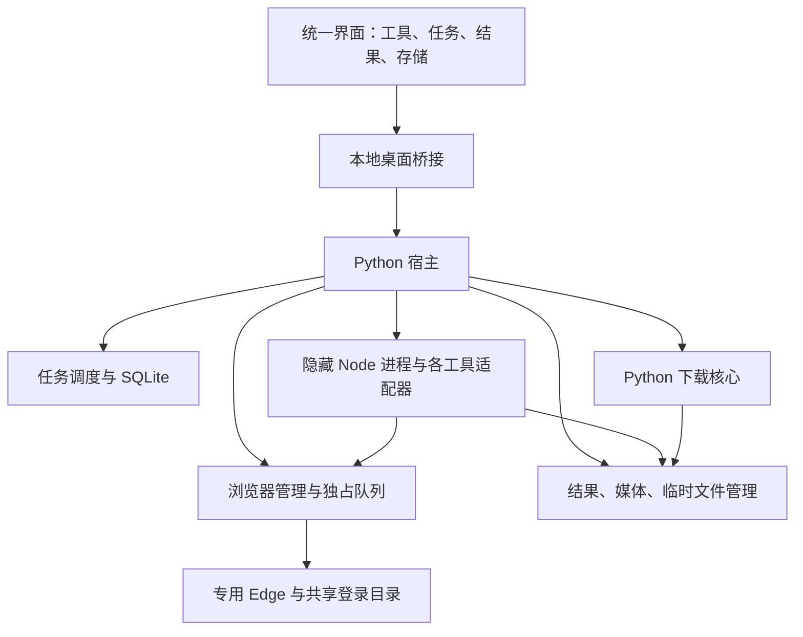

# 电商工具箱第一版：技术设计与重构方案

> 文档版本：0.1；日期：2026-10-11。
>
> 状态：设计基线，尚未实现桌面工具箱。本文中的新模块、目录与接口均为待实现设计。
>
> 总仓：`Script All`；开发分支：`codex/ecommerce-tool-library`；集成分支：`main`。

## 1. 阅读与执行顺序

1. 阅读本文，理解目标、模块边界、数据归属和各工具迁移要求。
2. 阅读[接口与数据约定](TOOLBOX_V1_CONTRACTS.md)，实现公共部分时以该文档为准。
3. 按[实施与验收清单](TOOLBOX_V1_EXECUTION.md)逐步开发，记录实际验证证据。
4. 涉及范围、业务规则或数据删除规则的变化，先修改设计和相关验收项，再修改代码。

本文区分“已检查的现状”“已决定的目标”和“需要真实页面验证的能力”。设计完成不能作为功能完成的证据。未实际运行的验证必须保持未完成状态。

## 2. 用户目标与第一版边界

### 2.1 目标用户

普通电商运营人员。他们通过按钮、表单、列表和系统文件选择窗口操作，不需要理解源码目录、命令行、环境变量、浏览器调试端口或语言运行环境。

第一版的正常使用路径：安装工具箱 → 打开软件 → 登录平台 → 选择工具和条件 → 启动任务 → 查看结果 → 按需导出。

### 2.2 第一版工具

| 工具标识 | 界面名称 | 现有业务来源 | 第一版工作 |
| --- | --- | --- | --- |
| `business-center` | 商机中心 | 根目录下的 Node 商机中心项目 | 迁移条件、采集、恢复和 Excel 结果 |
| `top200` | TOP200 商品榜 | Tiktok TOP200 | 迁移榜单条件、采集、恢复和 Excel 结果 |
| `video-ranking` | 自动短视频采集 | Tiktok video | 迁移自动榜单采集、下载、文案和去重 |
| `manual-video` | 人工视频工作台 | 现有 Python 下载器，加上新页面提取能力 | 当前页读取、勾选追加、复制标题和链接、下载 |

- 人工提取采用工具箱内操作，第一版不制作独立浏览器扩展。
- 罗盘短视频榜是人工提取的必需支持项。抖音作者主页和首页推荐流分别验证，稳定支持后才开放对应入口；两者不作为第一版发布阻塞项。
- 第一版重做统一导航和交互，不采用把旧页面嵌入 iframe 的方式。
- 其他工具继续作为独立源码项目保留，暂不接入工具箱。尤其不改动商品标题写入流程和成本工具的业务备份机制。
- 第一版不实现付费、账号授权、云端任务、在线更新或服务器文件同步。以后可在本地应用边界外增加这些服务，本次不预建空接口或占位界面。

### 2.3 必须满足的结果

- 四个工具从统一窗口启动，界面不要求填写文件路径、Node/Python 地址或调试端口。
- 工具运行时不会互相切换采集页面、覆盖历史 Excel 或误删其他任务视频。
- 数据不写进安装目录或源码目录；卸载或更新程序不自动清除用户结果。
- 相同视频内容不重复保存；缓存有清理规则；最终结果由用户决定何时删除。
- 没有 Python、Node 的目标电脑可以通过安装包使用。

## 3. 已检查的现状与问题

| 部分 | 当前代码事实 | 重构动作 |
| --- | --- | --- |
| 独立服务 | 三个首批 Node 工具默认都使用 8080 | 工具箱调用业务引擎，发布时不启动旧 HTTP 服务 |
| 浏览器 | 多工具使用 9222，但浏览器用户目录分别放在不同临时位置 | 宿主统一管理浏览器、连接和持久登录目录 |
| 商机报告 | 历史 JSON/Markdown 有时间名，最终 Excel 使用固定名称 | 每个任务独立保存 Excel，历史结果绑定固定 artifact |
| 任务存储 | 商机和 TOP200 在任务文件外再写完整 checkpoint；视频重复保存 checkpoint 和日志 | 每个任务只保留一个权威引擎状态，摘要进入数据库 |
| 模块导入 | 三个 task-store 在导入时初始化默认目录 | 工具箱使用显式创建的 store，导入模块不写源码目录 |
| TOP200 报告 | 完整任务又被导出一份 JSON，历史列表仅限制显示数量 | 去掉冗余整份任务备份，历史分页不掩盖磁盘占用 |
| 自动视频 | 下载到工具目录内的“视频”；旧去重流程会扫描并删除历史重复文件 | 改为受管媒体存储和引用，不允许引擎删除其他任务资产 |
| Python 下载器 | Tkinter 界面和下载函数在同一文件，用户自行选择路径 | 分离下载核心，接入统一任务与导出界面 |
| 人工链接读取 | 仓库中没有用户提到的旧视频链接扩展 | 新增页面读取适配器，不把成本扩展当成已有视频提取能力 |
| 桌面先例 | 成本工具已有 pywebview/WebView2 与 PyInstaller 打包方案 | 参考桌面启动和打包经验，不依赖整个成本项目 |

现有自动短视频代码能在正常播放后取得媒体地址和标题，但这不等于已经能够取得每条视频的公开分享链接。当前未连接真实罗盘调试页面，该能力必须在阶段 01 验证。

## 4. 技术选择与模块职责

### 4.1 技术栈

| 层 | 选择 | 原因与代价 |
| --- | --- | --- |
| 桌面宿主 | Python 3.13、pywebview、WebView2 | 与已有桌面实践一致，保留 Python 下载核心；需处理 Python/Node 两种引擎 |
| 界面 | 本地 HTML、CSS、JavaScript ES modules | 四个工具的表单和结果列表不需要引入大型前端框架；公共组件按实际复用提取 |
| 任务数据库 | Python 自带 SQLite | 本地单用户数据，不需安装数据库服务 |
| Node 引擎 | Node 24.x，Playwright-core、ExcelJS 等首批工具实际依赖 | 复用已运行的采集与 Excel 业务代码；构建时锁定实际补丁版本 |
| 公网视频下载 | requests 与现有 Playwright Python 下载逻辑 | 保留解析、音视频合并能力，补充取消与事件回调 |
| 媒体处理 | 一份共享 FFmpeg | 支持分离音视频合并及现有视频指纹逻辑 |
| 托盘 | pystray | 提供恢复窗口和明确退出入口 |
| 发布 | PyInstaller onedir + Inno Setup 按用户安装 | 共享运行文件，不把各工具打成多份独立 exe；构建机需安装打包工具 |

源项目声明的 Node 最低版本不在本次无关调整中全部升级。工具箱发布运行时使用锁定的 Node 24.x；Python 和 Node 各依赖清单均在实施时落盘并锁定，通过验证后记录进构建清单。

### 4.2 架构



首批目标结构放在 `toolbox/` 内：`host/` 管理桌面、任务、数据库、浏览器和文件；`web/` 放统一界面；`node/` 放进程入口与工具适配器；`tests/` 放公共能力测试；`windows/` 放打包与安装脚本。现有工具业务核心仍留在各自项目目录，避免一次性移动所有源码。

| 模块 | 负责 | 禁止越界 |
| --- | --- | --- |
| 界面 | 表单、状态显示、勾选、调用白名单操作 | 不拼接磁盘路径，不执行命令，不持有数据库连接 |
| 桌面桥接 | 参数校验、任务操作、系统选择窗口、按结果 ID 导出 | 不接受任意命令和任意文件读取请求 |
| 任务调度 | 状态转换、排队、取消、恢复、引擎生命周期 | 不实现榜单筛选算法 |
| 浏览器管理 | Edge 发现、启动、登录目录、连接端口、资源锁 | 工具不得绕过它启动另一份店铺会话 |
| 工具适配器 | 新旧参数与状态转换、调用业务核心 | 不启动旧网页服务，不对外暴露旧 token/session API |
| 业务核心 | 采集、解析、排序、Excel 生成、下载与指纹 | 不决定用户数据根目录，不关闭共享 Edge |
| 文件管理 | 受管路径、文件注册、去重、导出、删除与清理 | 不扫描任意用户目录，也不清除源码或依赖目录 |

### 4.3 隔离、进程与关闭

- 宿主只允许一个实例，第二次打开恢复已有窗口，避免两份任务调度器同时工作。
- Node 工作者通过 UTF-8 NDJSON 标准输入输出通信；日志写 stderr，stdout 只写协议消息。宿主负责进程树和错误收敛。
- 一个 Node 业务任务失败不能结束桌面宿主，也不能改变其他工具的数据。
- Python 下载核心在受控后台线程运行，每个线程独立创建并释放其 requests/Playwright 对象；界面线程不执行下载。
- FFmpeg 与 Node 等后台进程隐藏窗口。供用户登录和浏览的 Edge 正常显示。
- 主窗口关闭转为隐藏，托盘保留；明确退出时先取消任务、保存状态和回收所属后台进程。不可恢复的网络传输停止后从该文件重新下载。
- 不关闭用户日常浏览器，不向其他 Edge 用户目录写入登录数据。

## 5. 界面与操作流程

### 5.1 公共界面

左侧四个工具入口，另设任务中心、结果中心和存储设置。公共状态区域显示浏览器连接、平台登录是否需要检查以及正在占用浏览器的任务。

- 条件输入、开始、暂停/继续、停止、重试失败项使用一致的位置和文案。
- 每个工具保留自己的业务字段，不能把不同榜单、周期或销量条件强制合并为同一套参数。
- 历史任务分页显示全部记录，支持按工具和状态筛选，不用“只显示十条”代替存储管理。
- 数量型进度显示已处理/总数；尚不能估算总数时只显示阶段和计数，不虚构百分比。
- Excel 预览读取任务的权威业务数据，以分页方式展示；Excel 是可交付格式，不作为界面唯一数据源。
- 视频结果按任务和商品分组，展示文案、下载状态和重复引用说明；播放由宿主按结果 ID 打开受管视频。
- 第一版不展示其他未接入工具的可点击假入口。

### 5.2 商机中心与 TOP200

打开工具 → 检查/登录平台 → 读取当前可用类目及榜单条件 → 选择条件 → 创建任务 → 排队/采集 → 结果预览 → 系统保存窗口导出。

条件发现同样会控制页面，因此也必须进入浏览器队列。过期的条件缓存允许展示，但开始前由引擎检查其仍有效；无效时提示重新读取，不能静默换成其他选项。

### 5.3 自动短视频采集

选择类目、品牌、周期和现有趋势模式 → 创建任务 → 按原榜单规则运行 → 查看视频及文案 → 导出选中结果。

保留现有前 200 名扫描边界、符合条件判断、商品命名、每商品最多四条以及去重后继续寻找候选的逻辑。具体边界以迁移前代码和测试为准；重构若发现原规则矛盾，先记录案例再修订，不顺便更改。

### 5.4 人工视频工作台

1. 在工具箱打开目标网站，在它管理的 Edge 中登录并浏览。
2. 点击“读取当前页”；多标签时显示可读标签的标题与来源，用户选定目标。
3. 返回当前页/已加载范围内的视频列表，勾选需要的条目。
4. 用户继续翻页或滚动，再点击读取，追加到待选列表；重复条目合并。
5. 点击下载创建任务，或复制标题/链接、导出选中列表。
6. 粘贴分享文案或链接也进入同一待选列表，继续使用现有合法抖音域名及公开页面判断规则。

读取不下载媒体、不自动翻页、不主动遍历作者全部作品。在罗盘本页内，允许展开“更多视频”及正常播放器读取当前商品信息，操作完成后关闭自己打开的浮层，不更改榜单条件。页面变化导致定位失效时重新读取，不能按旧行号下载另一个视频。

链接区分公开页面地址与临时媒体地址；复制时明确标明类别。临时链接不保证有效期限，重启后没有可用解析信息时提示重新读取。没有可取得的链接时仍显示已取得的标题和原因，禁止伪造视频 ID 或把标题拼成链接。

公网分享链接用 Python 下载核心；必须依赖当前罗盘会话的来源，用 Node 页面下载能力并进入浏览器队列。两种方式生成相同的结果记录。

### 5.5 导出与删除

- 选择导出目标使用系统对话框，取消对话框不修改任务状态。
- Excel 导出不覆盖现有文件，除非用户在系统对话框中明确同意。
- 视频批量导出使用选择文件夹对话框，内部按任务/商品分组、清理非法文件名、处理重名；文案以配套 txt 导出。
- 内部视频按内容存一份，展示名称和文案属于任务引用，同一视频在不同任务可有不同标题。
- 删除前显示涉及的任务数、文件数、预计可释放空间和共享文件保留说明。执行中任务需先停止，不提供强制删除正在使用文件的操作。
- 删除工具箱结果不删除用户已导出到外部的副本。

## 6. 浏览器会话与调度

### 6.1 会话归属

宿主自动寻找 Edge 的系统注册位置和常见安装位置。未找到时显示安装提示，不要求用户填写 exe 路径。浏览器配置保存在数据根目录内的 `browser-profile/`，不放 TEMP。

浏览器连接仅监听本机回环地址，端口由宿主选择并检查握手。发现端口属于其他进程时换端口或显示重试提示，不接管来历不明的 9222 会话。适配器只使用本次宿主给出的连接地址。

店铺网站和抖音网站使用同一浏览器配置，但不同网站仍可能需要分别登录。界面不能把“Edge 已连接”误报成“所有平台均已登录”。

### 6.2 资源规则

| 资源 | 并发 | 持有范围 |
| --- | --- | --- |
| 受管浏览器 | 1 | 条件发现、榜单采集、当前页读取、需要会话的下载 |
| 公网视频下载 | 1 | 不依赖店铺会话的下载任务，与浏览器任务可并行 |
| 结果导出 | 宿主串行 | 仅执行本地文件操作，不占用浏览器 |

- 浏览器任务按入队顺序执行；任务提交后立即出现在任务中心。
- 暂停及等待用户完成登录/验证时保留浏览器锁，界面说明占用原因。用户可以继续任务或停止以释放资源。
- 用户手动改变正在采集的页面时，引擎校验页面、条件和业务身份；不匹配则等待用户处理，不继续采集错误位置。
- 宿主退出或进程异常后，锁不会作为永久有效状态保留；重启将相关任务转成中断，重新排队时重建连接和页面条件。
- 第一版不实现多店铺、多个账号并行采集。公共下载器自行启动的独立公开页面解析浏览器不复用店铺用户目录。

## 7. 数据、结果与磁盘控制

### 7.1 数据布局

默认根目录为 `%LOCALAPPDATA%/ScriptAllToolbox/`。第一版不提供手工编辑根目录的设置，避免路径迁移与存储引用不一致。

```text
ScriptAllToolbox/
  toolbox.sqlite3            任务摘要、配置、结果索引、媒体引用、人工待选条目
  tasks/<taskId>/
    engine-state.json        业务结果与检查点的唯一引擎状态
    artifacts/               本任务 Excel 等独占最终文件
    scratch/                 工作中间文件，不属于最终结果
  media/<sha256-prefix>/     按内容散列保存的共享视频文件
  browser-profile/           受管 Edge 登录数据
  logs/                      轮转日志，总容量不超过 50 MiB
  cache/                     可重建缓存
```

数据库不重复存整份采集结果；引擎状态不再另存同内容 checkpoint。Excel 和权威业务数据用途不同，允许各存一份；禁止把完整任务又复制到历史 JSON、latest JSON 和备份目录。

### 7.2 文件写入和结果登记

1. 引擎在当前任务 scratch 中写临时文件，阶段完成后关闭文件句柄。
2. 宿主校验文件属于该任务、类型与完整性，视频计算内容 SHA-256。
3. 相同内容命中现有媒体时复用文件，新增任务引用；不同内容登记新文件。
4. 文件进入受管位置后，在数据库事务中登记 artifact 和 task-artifact 关系。
5. 只有登记成功才在界面显示为可打开结果，删除多余临时副本。

文件系统与 SQLite 不能组成单个原子事务，因此启动时必须协调“文件已写入但未登记”和“记录存在但文件丢失”的情况。前者按未引用临时内容清理，后者标记结果缺失并提供重试/删除记录操作，禁止当成成功文件返回。

报告文件的正式名称必须带任务 ID 或放在任务独占目录。部分结果和最终结果区分角色；同任务重试后先原子写出新版本再替换该任务旧结果，不修改其他任务文件，也不无限累计重试版本。

### 7.3 去重边界

- 精确相同视频按 SHA-256 共用实际文件，两类视频工具均遵守。
- 自动采集保留原有视觉相似判断阈值和选择规则；命中时记录复用来源，不删除已有任务文件。
- 人工勾选的视频只自动做内容完全一致去重，不因为视觉相似而擅自排除用户所选内容。
- 文案与视频内容分开关联，重复视频不应导致新任务的标题丢失。
- 文件名不参与判断视频身份，标题相同不能作为不同视频相同的证据。

### 7.4 保留与清理

| 数据 | 默认策略 | 用户入口 |
| --- | --- | --- |
| 最终 Excel、视频及任务文案 | 不自动删除 | 结果中心、存储管理 |
| 可恢复任务的状态 | 保留直至恢复、明确放弃或删除任务 | 任务中心 |
| 成功任务 scratch | 任务结束后清理 | 自动处理 |
| 失败/停止任务 scratch | 仅删除引擎确认不属于恢复依赖的部分 | 存储管理显示占用 |
| 无有效任务归属的临时文件 | 启动核对后清理 | 自动处理 |
| 缩略图/条件缓存 | 可重新生成，清缓存不影响最终结果 | 清理缓存 |
| 日志 | 轮转，最多 50 MiB；当前故障摘要留在任务记录 | 查看详情 |
| 浏览器配置 | 与缓存分开，清缓存不清登录 | 明确“清除平台登录”操作 |

日志达到限制时优先删除旧轮转文件，不能通过把日志完整放进 task JSON 绕过容量上限。运行中的临时文件、浏览器配置和恢复依赖禁止被通用缓存扫描器删除。

### 7.5 删除一致性

删除先在事务中标记结果不可用并移除目标任务引用；仍有引用的共享媒体保留。无引用文件进入待删除状态，删除文件成功后移除索引。遇到播放器占用等错误保留待删除记录，显示“等待释放”，稍后重试，不能显示已释放不存在的空间。

### 7.6 旧数据清理

先盘点源码之外的运行输出，保留每个首批工具一个脱敏小样本及回归需要的最小素材。视频测试素材优先本地合成，Excel 基准优先由文本 fixture 生成。

真实数据清理在新工具验收后执行：列出实际绝对路径、数量、体积及保留样本；确认路径在指定工具运行目录内后，用 PowerShell 原生命令处理。不要递归删除总仓、工具源码、Git、依赖或成本数据库。源码中若已有跟踪的输出文件，先逐项识别再移除跟踪，不能直接把整个数据目录当成垃圾。

## 8. 各工具迁移约束

### 8.1 商机中心

- 复用类目发现、销量条件、成交增长判断、分组和 Excel 列定义。
- 为 task-store 增加显式上下文创建路径，工具箱模式不能初始化 `__dirname` 默认存储。
- batch-runner 及其采集子进程接收宿主的目录、CDP、控制文件和结果位置；子进程也必须隐藏并可回收。
- 报告生成增加工具箱输出模式：保存任务独占 Excel，Markdown 如需用户导出则按需生成，不自动写 latest 和同内容历史副本。
- 保留按类目恢复和失败项重试；已完成业务结果不得因恢复清空。

### 8.2 TOP200

- 复用现有类目、品牌、榜单发现、趋势解析和商品链接解析。
- 保留“实时优先，否则近 1 天”和前 200 名规则，以及 Excel 汇总、榜单明细、失败记录和北京时间格式。
- task-store 和 export-excel 改为注入路径；工具箱模式去除完整任务 JSON 报告副本。
- 新界面独立实现历史分页，旧服务的 token、Origin 检查不复制为新桌面通信协议。

### 8.3 自动短视频

- `VIDEO_DIR`、日志、引擎状态与 FFmpeg 由上下文提供。
- 检查点使用相对于受管数据根目录的引用/结果 ID，不写死源码目录或其他电脑绝对路径。
- 去重索引由受管媒体注册表提供，不允许每次启动删除历史重复文件。
- 保留下载、音视频合并、趋势判断、文案和原指纹测试；新增“复用文件但保留任务关系”的测试。

### 8.4 Python 下载器与人工提取

- 将 URL 提取、公开页面解析、媒体下载、合并与命名函数分离到无 Tkinter 依赖的模块，独立旧 GUI 改为调用该核心。
- 下载核心接收工作目录、FFmpeg、取消标记、日志与进度回调；不以 cwd 决定正式结果目录。
- 保留连接/读取超时和临时文件清理，增加下载块之间及合并前后的取消检查。
- 公网下载可使用请求解析和独立 Edge 解析，不能在后台线程共享其他线程的同步 Playwright 实例。
- 人工读取适配器按来源区分罗盘、作者主页、推荐流，未验证的适配器不声明可用。
- 缺少公开视频 ID 时，条目身份以可验证页面来源及卡片特征确定；下载前再次核对，不能只依赖旧行序号。

## 9. 错误、恢复与基本边界

- 参数在界面和宿主两侧校验，业务选项由引擎再次检查；界面禁用按钮不能替代宿主检查。
- 错误使用稳定代码和中文说明，区分需登录、需验证、页面变化、链接失效、磁盘不足、文件占用、引擎退出和结果缺失。
- 登录和验证码交给用户在正常浏览器处理，任务显示等待；恢复先校验业务条件。
- 程序重启不自动重新跑中断任务，不自动重复导出或重新下载全部文件。
- 数据库仅宿主写入；Node 引擎不直接写 SQLite，避免双端状态冲突。
- 本地桌面桥接只向自有静态界面开放。远程网站在外部 Edge 展示，不允许远程网页取得本地文件操作桥接。
- 预览中的标题、错误和文案按文本呈现，不把页面来源文本直接插入 HTML。
- 日志不记录 Cookie、访问令牌、完整调试握手或带签名媒体地址；复制链接属于用户明确操作，不能顺带写入诊断日志。

## 10. 分发与未来收费边界

- Windows 10/11 x64，按当前用户安装；程序与数据分离。
- PyInstaller onedir 包共享 Python 库，Node 与 FFmpeg 各一份，Node 依赖只带业务引擎实际使用的部分。
- 不把每个工具的 `.venv`、`node_modules`、旧 exe、build、dist、测试报告和浏览器资料整目录复制进发布包。
- 不捆绑整套 Chromium，使用目标电脑 Edge 进行自动化；未安装时提供清楚的安装指引。
- WebView2 Runtime 与 Edge 浏览器分别检测；缺失时安装程序引导通过微软 Evergreen bootstrapper 安装。已有共享运行时则不重复安装。
- 安装包升级先要求退出工具箱，再替换程序文件。用户数据保留；SQLite schema 变更按版本事务迁移，失败时拒绝启动任务并保留原数据。
- 第一版卸载保留数据，删除数据通过工具箱明确操作。暂不实现在线自动更新和付费协议。
- 构建清单记录工具箱版本、源码提交、运行时及依赖版本、文件列表、安装包大小与 SHA-256。交付时报告实测包体，不预先承诺固定大小。

## 11. 验收、变更控制与下一步

全部具体测试及执行顺序见[实施与验收清单](TOOLBOX_V1_EXECUTION.md)。任何阶段都遵守：改动范围明确 → 检查既有行为 → 小步实现 → 核对结果 → 记录证据 → 再进入依赖该能力的阶段。

阶段 01 的真实页面验证可以因登录尚未完成而保持待验证，公共本地基础继续推进；人工读取能力在证据齐备前不能标记完成。可选抖音页面不支持时记录实际原因并隐藏入口，罗盘必需能力失败时必须修复或与用户重新明确范围，不能悄悄删减后发布。

完成后沿用“开发分支提交 → 合并 main → 推送远端 → 推送成功再删开发分支”的流程。本次写技术文档不代表整体开发已完成，不提前合并、推送或删除当前分支。

## 12. 官方技术资料

以下资料用于技术选择，不能代替本项目的实际构建和运行验证。

- [pywebview 打包](https://pywebview.flowrl.com/guide/freezing)：支持 PyInstaller，构建环境需避免捆入未使用 GUI 依赖。
- [WebView2 Runtime 分发](https://learn.microsoft.com/microsoft-edge/webview2/concepts/distribution)：生产应用使用 Runtime；Evergreen 可共享，安装前检测。
- [Playwright connectOverCDP](https://playwright.dev/docs/api/class-browsertype#browser-type-connect-over-cdp)：连接现有 Chromium 浏览器；能力与 Playwright 自身协议连接有差异，需真实页面验证。
- [pystray 与 GUI 集成](https://pystray.readthedocs.io/en/latest/faq.html)：Windows 可把托盘循环放入后台线程，桌面主循环保留主线程。
- [Node 发布周期](https://nodejs.org/en/about/previous-releases)：发布构建选取并记录受支持的运行版本。
